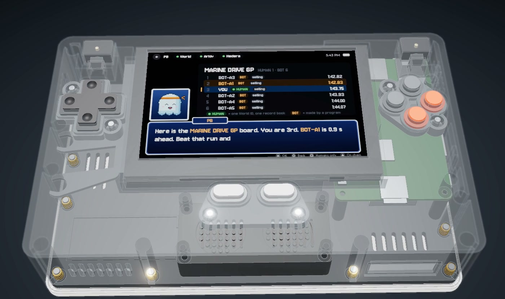
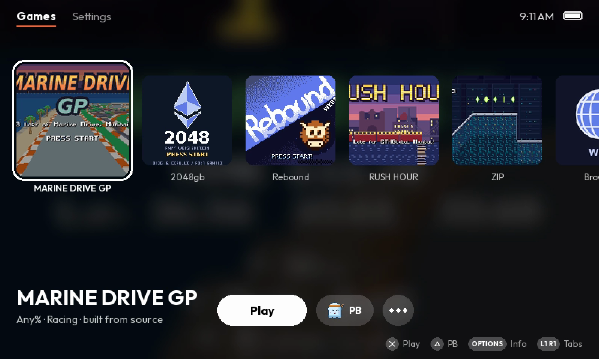
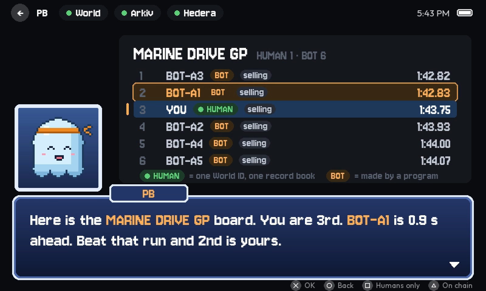
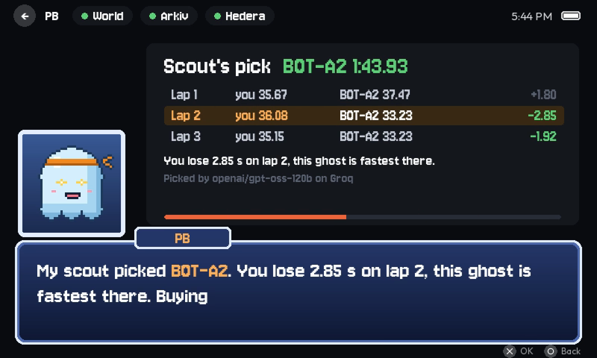
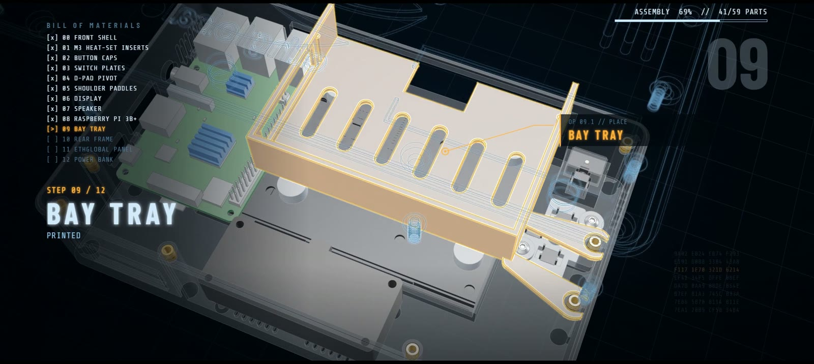
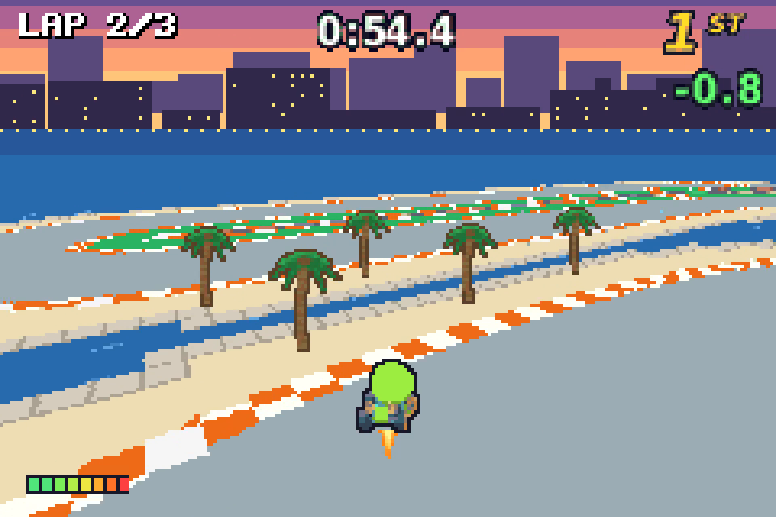
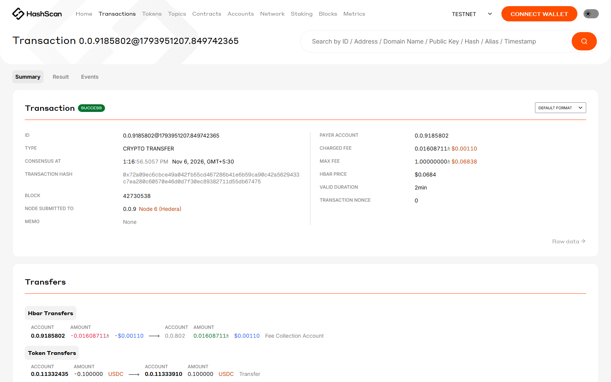
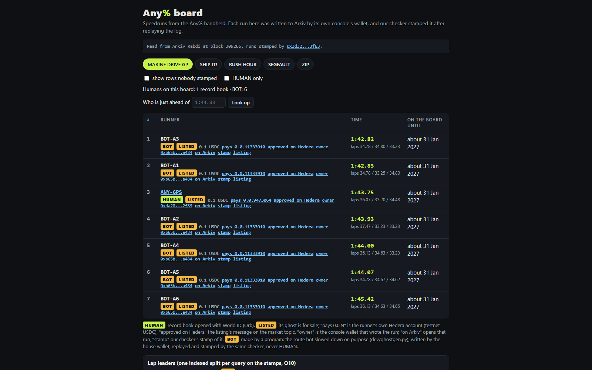

# Any%



**A handheld speedrun console where every run is provable.** The games record their inputs, and anyone can replay a
run's log to re-derive its time: the log either replays to the claimed time (VERIFIED) or it doesn't (REJECTED).

[Public board](https://chrsnikhil.github.io/anypercent/) ·
[ROMs and films (release)](https://github.com/chrsnikhil/anypercent/releases/tag/mumbai-demo) ·
[World](#world-one-console-one-person) · [Arkiv](#arkiv-the-console-owns-its-records-the-checker-stamps-them) ·
[Hedera](#hedera-pb-pays-over-x402) · [Run it](#run-it) · [Repo map](#repo-map)

| The console's home | The board, read from Arkiv | PB's scout picks a ghost |
|---|---|---|
|  |  |  |

## What Any% is

Any% is a handheld (a Raspberry Pi in a printed shell) with five arcade games built for it. Each game is deterministic:
its rules are plain C, shared by the console build and a PC replay tool, and a run is its input log. Replay the log and
you get the same frames, the same final state and the same time. That makes a board where every time was replayed
before it was posted, instead of one moderated by people watching videos.

A replay answers "is this time real?". It cannot answer two other questions, and Any% is built around them:

- **How many humans are on this board?** One person with 100 wallets looks like 100 runners, and a bot's run is a valid
  run: there is no run to refuse. The HUMAN tier shows which records have one real human behind them: HUMAN means a
  record book opened with a World ID Orb proof stands behind the run. It does not mean a human pressed every button.
- **Did a human approve this money moving?** PB's scout spends on your behalf, and listings bring in testnet USDC. The
  same human who owns the record book approves in World App, with the exact text.

## How a run becomes real

1. **Play.** The game records every input (the arcade kit's recorder, `arcade/`) into a run log: a header (game, rules
   version, claimed frames) and the inputs.
2. **Replay.** Our checker runs the game's own replay tool (`arcade_replay`, built from the same C rules as the ROM) on
   the log. It must finish, match the claimed time and give the same final hash; `arcade_splits` gives the lap times
   from the same replay. Anything else is REJECTED and nothing is written.
3. **Approve.** The runner approves the listing in World App, word for word
   (`List MARINE DRIVE GP 1:43.75 ghost for 0.10 USDC to 0.0.9473064 on the public board`). The approved text goes to a
   Hedera topic as a LISTING.
4. **Record.** The console's own Arkiv wallet signs one transaction that creates the run and its listing. The checker
   reads them back, and if they are exactly what it issued after the replay, it writes a separate **stamp** that names
   the run and the console wallet that owns it.
5. **Rank.** Every board (the console, the web board, PB's scout, the buyer's checks) ranks stamped runs only.

**Replay one yourself.** A listed ghost's log is on Arkiv only encrypted until it is bought, but every BOT ghost is made
by a public program, so anyone can regenerate one byte for byte and replay it (inside the WSL sandbox, `sandbox/`):

```bash
cd games/marinedrive
make -f tools.mk host replay splits
/opt/arca-sandbox/venv/bin/python dev/ghostgen.py --out out/ghostgen/default --set default
out/arcade_replay out/ghostgen/default/v1.acl     # time_frames, final hash, hash_matches
sha256sum out/ghostgen/default/v1.acl             # equals the BOT run's log_h on Arkiv
```

The other games replay the same way: SHIP IT! is `game/`, RUSH HOUR `games/rushhour`, SEGFAULT `games/segfault`, ZIP
`games/zip` (`make -f tools.mk replay`).

## The hardware



| Part | What |
|---|---|
| Board | Raspberry Pi 3B+ (1 GB), Raspberry Pi OS Lite 64-bit (Debian 13 trixie), no desktop |
| Screen | Waveshare 5 inch DSI, 800 x 480, capacitive touch |
| Sound | PAM8403 amplifier and a DFRobot FIT0502 speaker, from the Pi's 3.5 mm jack |
| Input | a PS5 DualSense over Bluetooth, and the touchscreen |
| Power | a USB-C power bank in the shell's bay |
| Shell | printed: front shell, rear frame, bay tray, SD hatch, switch plates, buttons, display bezel, and swappable sponsor panels held on magnets |

- **CAD:** [`cad2/`](cad2/) is the shell in OpenSCAD (every dimension a named parameter), with its STLs, the assembled
  model, the fit checks and previews. [`cad/`](cad/) is a design for a different kit (GamePi43) that the console
  does not use.
- **Print files:** [`prints/`](prints/): the print-ready STLs, the printing guide (PDF) and Bambu P2S multi-colour
  projects for every part, panel and reprint.
- **Renders and viewers:** [`render/`](render/) (the Blender product render) and the HTML viewers at the root
  (`Any% Product Viewer.html`, `Any% Build Guide.html`, `stl_viewer.html` and others; open one in a browser).
- **Device:** [`device/`](device/) is everything the Pi runs besides the launcher: systemd units, udev rules, the
  firewall (inbound SSH only from the owner's hotspot and, over Tailscale, the owner's laptop), the touch overlay and
  the browser kiosk.



## The games

| Game | Id | Source | What |
|---|---|---|---|
| MARINE DRIVE GP | MDGP | `games/marinedrive` | a Mode 7 kart racer: three laps of Marine Drive, Mumbai, against three rivals and a ghost |
| SHIP IT! | SHIP | `game/` | run a hackathon office at ETHGlobal Mumbai and ship before the deadline |
| RUSH HOUR | RUSH | `games/rushhour` | a platformer: late for registration, run across Mumbai's streets, awnings and train roofs to the venue door |
| SEGFAULT | SEGF | `games/segfault` | a first-person raycaster shooter: clear the bugs from the build server room the night before demo day |
| ZIP | ZIPG | `games/zip` | a momentum platformer: a data packet races through the venue network to the demo-day screen |

They are Game Boy Advance homebrew built with Butano on our arcade kit (`arcade/`: the deterministic rules contract, the
recorder, the replay and splits tools). Each game has its `CREDITS.md` (Kenney's CC0 packs, Butano's fonts, zlib) and
its own original theme song, written as code in `games/music/`. Built ROMs are in the
[release](https://github.com/chrsnikhil/anypercent/releases/tag/mumbai-demo); the console's launcher (`launcher/`)
runs them in RetroArch's mGBA core.

## World: one console, one person

**Track:** Best Use of IDKit (From Scratch).

**What we built.** A record book per human, opened with a World ID 4.0 IDKit proof (`proof_of_human`, Orb), and World
App approvals for every action that moves money or binds a console. The service is `apps/world-bridge` (the IDKit
request builder is `realIdkitDeps` in `src/idkit.ts`); the console's adapter is `launcher/arca_launcher/handler/world.py`.

- **One World ID opens one record book.** World ID's own one-time nullifier on the action `anypercent-book` backs it,
  and the bridge's nullifier store backs that. A second sign-up by the same human is the alternative path, shown live
  with the owner's own World App: "Already registered" (World App: `nullifier_replayed`).
- **One console, one person.** A console is linked to the record book that signed up on it. Another person's sign-up
  there is refused before anything is sent to World, so their World ID is not used up and no book is made (shown from
  tests: the demo has one human).
- **Linking or releasing a console** takes the owner's approval in World App, with the exact text, from the owner's
  terminal (`npm run console:link`, `console:release`). The link names the console's Arkiv wallet, so that wallet is
  the one the checker stamps runs for: `Link console C-FMHE (wallet 0xda28…2f89) to record book ANY-6PS: PB on it
  spends this book's coach budget`. A console that reports another wallet later is not linked for stamping until the
  owner approves a new link. PB on a console spends only from the book it is linked to.
- **Every money move needs that human's approval in World App:** a listing (`List MARINE DRIVE GP 1:43.75 ghost for
  0.10 USDC to 0.0.9473064 on the public board`), and a house batch of BOT ghosts (`Publish BOT batch 8477d8: 6 MARINE
  DRIVE GP ghosts made by a program, 0.10 USDC each to house 0.0.11333910 on the public board, never HUMAN`).
  Approvals are IDKit session proofs: the owner proves the World ID session made at sign-up, and World App shows the
  text.

| What | Value |
|---|---|
| World ID | 4.0, IDKit, production environment, the real World App with an Orb credential |
| Action (sign-up) | `anypercent-book` |
| App id | `app_d20961b677d95de13db2f8fd4927bd79` |
| The live take's console and book | handheld `C-FMHE`, record book `ANY-6PS` |

**Limits.** World binds the record book, not whose hands played. The console id is a random file in the console's
state folder: copying the folder copies the console (and its wallet). The service does not authenticate consoles; a
console's wallet counts only once a World-approved link names it. Agent Pass is built (`APPROVALS=agentpass`) but not
shown: the owner's account gets `account_not_eligible` from World's portal, so approvals run on IDKit sessions.

## Arkiv: the console owns its records, the checker stamps them

**Track:** Build on Arkiv (from scratch). Arkiv's Rabdi testnet, chain id `7794095`, RPC
`https://rpc.rabdi.db-chain.testnet.arkiv.network`, explorer https://rabdi.explorer.arkiv.network.

**What we built.** The public board of every game, on Arkiv. The server decides a time is real; the console owns the
record of the run.

- **Each console has its own Arkiv wallet,** made on the device (a key file in its state folder, never sent anywhere).
  When a run is listed, the console signs one transaction from that wallet that creates the run and its listing
  (`launcher/arkiv_signer`, Arkiv's own SDK). The rows' `$creator` and owner is the console's wallet.
- **The checker only replays and stamps.** After the replay, the bridge issues the exact run and listing payloads; the
  console checks them against its own log and signs; the checker reads both back and writes a separate
  `anypercent.stamp` (the run's key, the console wallet, and the time, book or label, HUMAN and lap splits copied for
  the board). The checker holds no key that can write, change or delete a console's record: `npm run arkiv:tamper` has
  the server's key try, and it is refused.
- **Every board ranks stamped runs only.** A run counts when a checker stamp names it, the run's `$creator` is the
  wallet the stamp names, and the copied columns agree. A perfect copy written by any other wallet has no stamp and is
  ignored (`npm run arkiv:lookalike`, from the stranger `0x6CD1e043820e450A13B3F536F7a90ED2aDCfbCc1`).
- **BOT ghosts come from the house wallet**, made by our MARINE DRIVE GP route bot slowed down on purpose in chosen laps
  (`games/marinedrive/dev/ghostgen.py`), replayed and stamped by the same checker, labelled BOT, never HUMAN, and sold
  through the same x402 paywall. One batch transaction writes the records and one writes their stamps.
- **Arkiv features in use:** `$creator` pins on every read; read-only runs, listings and stamps; anyone can extend a
  run's and its stamp's lifetime (`permissionlessExtension`); listings end on their own after 7 days; runs and stamps
  expire at season end + 30 days; indexed `human` and lap splits `s1`..`s4` (so "fastest lap 2" is one query); ORDER
  BY with a range filter ("who is just ahead of me" is one query); a listed ghost's log only as AES-256-GCM `log_enc`
  until bought; predicted keys so a run and its listing land in one transaction; named schemas (`anypercent.run`,
  `anypercent.listing`, `anypercent.stamp`).

| Writer | Wallet | Writes |
|---|---|---|
| Each console | its own (the handheld C-FMHE: [`0xdA2855662F95B4a02232e3EEe445270EC6902f89`](https://rabdi.explorer.arkiv.network/address/0xdA2855662F95B4a02232e3EEe445270EC6902f89)) | its runs and listings |
| The house | [`0xb65bf2156C09883c06e24F08D969D890bC5ea484`](https://rabdi.explorer.arkiv.network/address/0xb65bf2156C09883c06e24F08D969D890bC5ea484) | the BOT runs and listings |
| The checker (stamper) | [`0x3d3260425Cb52F0c6716212274a883337aFa3f63`](https://rabdi.explorer.arkiv.network/address/0x3d3260425Cb52F0c6716212274a883337aFa3f63) | stamps only |

**The live take, on Arkiv** (the handheld's MARINE DRIVE GP 1:43.75, record book ANY-6PS):

| What | Id |
|---|---|
| The console's transaction (run + listing) | [`0xd2d522ad1750715618c12ad226a1dafd0277ddc759128c5eed7f7c78725a9e8c`](https://rabdi.explorer.arkiv.network/tx/0xd2d522ad1750715618c12ad226a1dafd0277ddc759128c5eed7f7c78725a9e8c) |
| The run | [`0x226e4415fad3cc052574ed63cce379bed1468112d5b3f79d967aa21914d9ede4`](https://rabdi.explorer.arkiv.network/entity/0x226e4415fad3cc052574ed63cce379bed1468112d5b3f79d967aa21914d9ede4) |
| The listing | [`0xcd3bbc796feaa153e87d8b64673b781c4350add1c2946949a3e450d320a55077`](https://rabdi.explorer.arkiv.network/entity/0xcd3bbc796feaa153e87d8b64673b781c4350add1c2946949a3e450d320a55077) |
| The checker's stamp | [`0xe1891b91f30f7ff91865178dda74190bb8522b3e3ceef3eda77b4db386b36fa5`](https://rabdi.explorer.arkiv.network/entity/0xe1891b91f30f7ff91865178dda74190bb8522b3e3ceef3eda77b4db386b36fa5), written in [`0x9513836a…3186`](https://rabdi.explorer.arkiv.network/tx/0x9513836ab705d97a832814f26fa2b4e4bee8f6a3abdb1e1ba3d66d7741c73186) |
| The house's BOT batch | records [`0xb41ea6ca…b357`](https://rabdi.explorer.arkiv.network/tx/0xb41ea6ca64da17cdaf2cab7a3abc5a69977786543815b3115e20d0873b20b357), stamps [`0x07fe222b…e417`](https://rabdi.explorer.arkiv.network/tx/0x07fe222b9ddd9aa9e6e0221e8a4897f6d58f02e436ec6d19878c6858237be417) |

### Run the query yourself

From any terminal, no key. First the checker's stamp of the handheld's run (it names the console wallet that owns it):

```bash
curl -s https://rpc.rabdi.db-chain.testnet.arkiv.network -H 'content-type: application/json' --data @- <<'EOF'
{"jsonrpc":"2.0","id":1,"method":"arkiv_query","params":["arkiv.schema = str('anypercent.stamp') AND run = key(0x226e4415fad3cc052574ed63cce379bed1468112d5b3f79d967aa21914d9ede4) AND $creator = addr(0x3d3260425Cb52F0c6716212274a883337aFa3f63)",{"select":{"key":true,"creator":true,"attributes":true},"limit":"0x1"}]}
EOF
```

Then the run itself, pinned to the wallet the stamp names (`console`); the answer's `creator` is the console, not us:

```bash
curl -s https://rpc.rabdi.db-chain.testnet.arkiv.network -H 'content-type: application/json' --data @- <<'EOF'
{"jsonrpc":"2.0","id":1,"method":"arkiv_query","params":["arkiv.schema = str('anypercent.run') AND $key = key(0x226e4415fad3cc052574ed63cce379bed1468112d5b3f79d967aa21914d9ede4) AND $creator = addr(0xdA2855662F95B4a02232e3EEe445270EC6902f89)",{"select":{"key":true,"creator":true,"expiresAt":true,"attributes":true},"limit":"0x1"}]}
EOF
```

The whole board of a game is the stamps, fastest first, each joined to its run the same way:
`arkiv.schema = str('anypercent.stamp') AND game = str('MDGP') AND season = i32(1) AND $creator =
addr(0x3d3260425Cb52F0c6716212274a883337aFa3f63) ORDER BY frames:u64 ASC` with `"limit":"0x64"`. "Who is just ahead of
1:44.83 (6290 frames)?" is the same with `AND frames < u64(6290)` and `ORDER BY frames:u64 DESC`, limit 1. Take out the
`$creator` pin to see what any wallet wrote, look-alikes included. Anonymous reads have a budget: an
`ANON_COST_LIMITED` answer means wait, or use an access key from hub.arkiv.network.

**The track's notes:** [schema](arkiv/schema.md), [how we use Arkiv](arkiv/how-you-use-arkiv.md),
[why Arkiv](arkiv/why-arkiv.md), [reach](arkiv/reach.md), [friction](arkiv/friction.md), and the board's snapshot
(`arkiv/snapshot.json`). Parts of these notes describe the board before the switch to console-owned records, when the
checker wrote every row; this README describes it as it is.

**Limits.** The server still decides what counts: one checker stamps, and it can withhold a stamp. It cannot change,
delete or own a console's record. A console's wallet is a key file on the console, and a console needs tGLM to write
(the owner funds it: `npm run arkiv:fund`). Our service holds the key that opens a listed ghost. Rows the checker wrote
itself before the switch have no stamp and left the board. Testnet only.

## Hedera: PB pays over x402

**Tracks:** AI Agents That Pay (x402), and No Solidity Allowed.

PB, the coach agent, buys a listed ghost over x402 and pays the seller's own Hedera account directly (the house account
for a BOT ghost), in testnet USDC. No human approves the payment: PB's limits are code next to its key. PB's scout, a
language model on Groq, picks which listed ghost to buy from the public lap times on Arkiv. HCS keeps the listing the
seller approved in World App, PB's intent (with the scout's model and reason) before it pays, and its receipt after.
Testnet only.

```
 Console (Pi or WSL)                 Laptop: apps/world-bridge (Node 22)                         Hedera testnet
   record ──────── HTTP ──────────> /hedera/record ── operator key ── LISTING ──────────────────> HCS topic
   pay ─────────── HTTP ──────────> /hedera/buy: PB's agent (guards, agent key)
                                       │ INTENT ───────────────────────────────────────────────> HCS topic
                                       │ GET /x402/ghost/{listing}           -> 402 + requirements
                                       │ GET /x402/ghost/{listing} + payment -> /verify, /settle ──> facilitator ──> HTS transfer
                                       │ 200 + the ghost + the settlement
                                       │ RECEIPT (once the mirror shows the transfer) ─────────> HCS topic
   load_ghost ──── HTTP ──────────> /arkiv/ghost {run, receipt = the payment's transaction id}
 Any x402 client ─────────────────> GET /x402/ghost/{listing}  (the same paywall)
 Mirror node (HTTPS, no key) <───── balances, associations, transactions, topic messages
```

| Party | Who | Holds |
|---|---|---|
| Client (buyer) | PB's agent in the service (`src/hedera/agent.ts`) | the agent key: test USDC, a little HBAR |
| Resource server | `GET /x402/ghost/{listing}` in the same service (`src/hedera/resource.ts`) | the ghost secret |
| Facilitator | https://x402.org/facilitator (Blocky402 as the fallback) | its fee-payer account: it pays the network fee and submits |
| Seller (payTo) | the listed runner's own account | nothing of ours; receives USDC |
| Recorder | the service's operator account | the topic's submit key; pays HCS fees |

### On-chain ids (Hedera testnet)

| What | Id | HashScan |
|---|---|---|
| Market topic (no admin key) | `0.0.11332437` | https://hashscan.io/testnet/topic/0.0.11332437 |
| PB's agent account | `0.0.11332435` | https://hashscan.io/testnet/account/0.0.11332435 |
| The house account (BOT listings pay it; ECDSA, no alias, associated with USDC) | `0.0.11333910` | https://hashscan.io/testnet/account/0.0.11333910 |
| ANY-6PS's seller account | `0.0.9473064` | https://hashscan.io/testnet/account/0.0.9473064 |
| Facilitator | https://x402.org/facilitator, fee payer `0.0.9185802` | https://hashscan.io/testnet/account/0.0.9185802 |
| Testnet USDC | `0.0.429274` | https://hashscan.io/testnet/token/0.0.429274 |
| A settled payment: 0.10 USDC, PB's agent to the house for BOT-A1's 1:42.83 ghost, by `npm run hedera:agent` (no console, no human) | `0.0.9185802@1794004897.987759644` | https://hashscan.io/testnet/transaction/0.0.9185802-1794004897-987759644 |
| Its INTENT and RECEIPT | #19 and #20 on `0.0.11332437` | https://hashscan.io/testnet/transaction/1794004902.831367589/message, https://hashscan.io/testnet/transaction/1794004911.405892569/message |
| A settled payment to a person: 0.10 USDC, PB's agent to ANY-6PS's seller account `0.0.9473064` | `0.0.9185802@1793930445.643007633` | https://hashscan.io/testnet/transaction/0.0.9185802-1793930445-643007633 |
| Its INTENT and RECEIPT | #7 and #8 on `0.0.11332437` | https://hashscan.io/testnet/transaction/1793930450.748974293/message, https://hashscan.io/testnet/transaction/1793930457.098249017/message |
| The handheld's listing, approved in World App, word for word | LISTING #17, `0.0.6421420@1794003650.055631848` | https://hashscan.io/testnet/transaction/0.0.6421420-1794003650-055631848 |

Every transaction id shown in the video is in the on-chain ids above. Run
`npm run hedera:verify -- <purchase or payment id>` to check that a purchase's INTENT, payment and RECEIPT agree.



### Setup

All of it runs in `apps/world-bridge` (full detail in its README, "Hedera"):

1. **Accounts.** At portal.hedera.com, a testnet account with an ECDSA key: the operator. Put its id and DER private key
   in `apps/world-bridge/.env` as `HEDERA_OPERATOR_ID` and `HEDERA_OPERATOR_KEY` (`.env.example` lists every name).
2. **`npm run hedera:setup`**: creates PB's agent account (ECDSA, no EVM alias, 5 HBAR), associates it with testnet USDC
   `0.0.429274`, creates the market topic with no admin key, and appends the ids and the agent key to `.env`.
3. **Test USDC** for the agent at https://faucet.circle.com (Hedera Testnet, the agent's `0.0.N` id).
4. **`npm run hedera:payto -- --book ANY-6PS --account 0.0.N`**: the seller's account, checked on the mirror node.
5. **`npm run hedera:smoke -- --pay-to 0.0.N`**: balances, the topic's keys, one HCS message, both facilitators, and
   one real x402 payment of 0.01 USDC, each with its HashScan link.
6. **`npm run hedera:agent -- --book ANY-K2Q --game MDGP --frames 6290`**: PB, with no console and no human, finds the
   listed ghost just ahead on Arkiv, pays for it over x402, checks the ghost, and prints the INTENT, the payment and the
   RECEIPT on HashScan.

### The payment flow

1. The console asks the service to buy the ghost the board names (`POST /hedera/buy`).
2. PB's guards run (table below): the listing and its run re-read from Arkiv (the run stamped by the checker, the
   listing written by that run's console), the payout account checked on the mirror, the caps, then a reservation that
   counts against them.
3. PB's INTENT goes to the market topic; a node must accept it before anything is signed.
4. PB finds the endpoint (`<service>/x402/ghost/<listing key>`, published by `/hedera/config`) and asks without paying.
5. The paywall answers 402 with one requirement: `exact` on `hedera:testnet`, USDC, `payTo` = the listing's `pay_to`,
   the listed amount, and the facilitator's fee payer.
6. PB checks the 402 against what it read from Arkiv itself: any mismatch, and nothing is signed.
7. PB builds the payment with `@x402/hedera`: a USDC `TransferTransaction` from the agent to `payTo`, its transaction
   id on the facilitator's fee payer, valid 120 s, signed by the agent key only.
8. PB sends it in `PAYMENT-SIGNATURE`.
9. The paywall checks that the payment accepts exactly the requirement it issues now, and asks the facilitator to
   `/verify` it.
10. It decrypts the ghost and checks its hash (a bad log is never sold), then asks the facilitator to `/settle`: the
    facilitator co-signs as fee payer and submits.
11. It records the sale and answers 200 with the ghost and `PAYMENT-RESPONSE`.
12. PB checks the settlement and the ghost's hash; the receipt is the payment's transaction id. Once the mirror node
    shows the transfer, PB posts its RECEIPT to the topic.
13. The console loads the ghost with that transaction id (`/arkiv/ghost`) and the race starts.

### PB's scout (an LLM on Groq that picks; code that pays)

1. Code picks the candidates: live listings at the listed price whose payout account can take USDC, not your own book,
   a BOT listing only when it pays the house, each faster than you overall or in at least one lap.
2. `openai/gpt-oss-120b` on Groq gets your lap times and theirs (seconds, ids `c1..cN`; no book, console or key) and
   answers with strict JSON: which candidate, which lap, one short sentence.
3. Every number in that sentence is checked against the lap times; anything that does not match gets our own sentence
   (`You lose 2.85 s in lap 2: BOT-A2 runs it in 33.23 s, you in 36.08 s.`).
4. If the model fails or is slow (6 s), PB falls back to the ghost just ahead and says so on screen.
5. PB's guards then run in full on the purchase. The model never decides whether to pay, how much, or to whom, and its
   output never reaches a guard. INTENT on Hedera records which model picked the ghost and why, before the payment is
   signed. A ghost the book already owns is never paid for twice: the console shows its earlier payment.

### PB's guards (no human approval, still safe)

| Check | Source of truth | If it fails |
|---|---|---|
| The buyer's record book was issued by this service | its store | no purchase (no budget) |
| Not the buyer's own book | the listing | no purchase |
| The console is linked to the buying book (when a console asks) | the service's console binding | no purchase |
| A BOT listing is not HUMAN and pays the house account | the listing | no purchase, nothing signed |
| The listing is live, written by the console that owns the stamped run, for the console's seller, at the listed price | Arkiv | no purchase (changed) |
| The run is live and stamped by our checker, with the same log hash and its sealed ghost | Arkiv | no purchase |
| The listing names a payout account that can take USDC | Arkiv, the mirror node | no purchase |
| 0.10 USDC a purchase; 1.00 a day per record book; 5.00 a day across all books; the agent holds enough | config, store, the mirror node | no purchase (budget) |
| Once per (buyer, game, seller, run) | store | the earlier receipt, nothing paid |
| The 402: one `exact` entry, testnet, USDC, at most 300 s | the 402 | nothing signed |
| The 402's `payTo` is the listing's payout account | Arkiv | nothing signed (`REFUSED payTo`) |
| The 402's amount is the listed price | Arkiv | nothing signed |
| The 402's fee payer is the facilitator's own | the facilitator's `/supported` | nothing signed |

`npm run hedera:evil402 -- --listing 0x...` runs PB against a paywall that names another `payTo` and shows the refusal:
INTENT goes to the topic, nothing is signed, and no RECEIPT follows it.

### No Solidity

Everything is the Hedera JavaScript SDK (`@hiero-ledger/sdk`) and the x402 libraries; `git ls-files '*.sol'` prints
nothing.
- **HTS:** the USDC payment is a `TransferTransaction` built and signed with the SDK (through `@x402/hedera`), and the
  agent's USDC association is a `TokenAssociateTransaction`.
- **HCS:** the market topic (`TopicCreateTransaction`, no admin key), its LISTING, INTENT and RECEIPT messages
  (`TopicMessageSubmitTransaction`, one chunk each), and every read of them through the mirror node's REST API.
- **HCS, the house:** a HOUSE message names each BOT batch its owner approved in World App, word for word, before its
  rows are written (the first, batch `8477d8`, is #9).
- **Accounts:** PB's agent account and the house account are `AccountCreateTransaction`s with an ECDSA key and no EVM
  alias.

### Claims and limits

- PB, your coach agent, buys a listed ghost over x402 and pays the seller's own Hedera account directly (the house
  account for a BOT ghost), in testnet USDC. No human approves the payment.
- PB's scout is a language model on Groq. It reads public lap times from Arkiv and picks which listed ghost to buy. PB's
  limits are code: the scout never decides whether to pay, how much, or to whom. If the model fails, PB falls back to
  the ghost just ahead and says so.
- Every number in the scout's reason comes from the lap times. We check them, and we use our own sentence when they
  don't match.
- PB's limits are code next to its key: 0.10 USDC a ghost, 1.00 a day per record book, and it only pays the account on
  the console's stamped Arkiv listing.
- The seller saw their Hedera account in World App when they approved the listing; the house's BOT batch was approved in
  World App with the batch, the price and the house account named.
- Before paying, PB posts its intent to a Hedera topic, with the scout's model and reason; after, a receipt once the
  mirror node shows the transfer. Nobody, including us, can delete or edit that topic's messages.
- Hedera SDK only: HTS moves the USDC, HCS keeps the record. No Solidity.

Limits: testnet USDC only. There is no escrow: the payment goes straight to the seller, and our service holds the ghost's
key. The scout reads split numbers only, never a ghost. The intent is submitted before the payment is signed; we do not
claim it reached consensus first. World binds the record book, not whose hands played. The laptop service must be on
for a purchase.

## The public board

**https://chrsnikhil.github.io/anypercent/** reads Arkiv straight from the browser, with no backend of ours: every
game's board (stamped runs only), the HUMAN and BOT badges, which ghosts are listed and the Hedera account each pays,
the lap leaders, "who is just ahead of my time", a record book's profile at `#book=ANY-XXX`, and a link from every row
to its run, stamp, listing and owner on the explorer. It works on a phone and needs no account. When Arkiv does not
answer it shows the last snapshot and says so. The page is `apps/world-bridge/public/board.html` (one file, no build);
the bridge also serves it at `/board`, and the console's browser opens it.



## Run it

**The service** (`apps/world-bridge`, Node 22):

```bash
cd apps/world-bridge
npm install
cp .env.example .env        # fill in World, then:
npm run arkiv:keygen        # the checker's, the stranger's and the house's keys and the ghost secret, into .env
npm run hedera:setup        # PB's agent account, the market topic (see "Setup" above)
npm start                   # http://127.0.0.1:8787, /health says which sponsors are live
npm test
```

Owner commands: `npm run console:link` / `console:release` (World App approves), `npm run arkiv:fund -- --to 0x...
--amount 1` (tGLM for a console's wallet), `npm run arkiv:snapshot` (the web board's fallback), `npm run hedera:agent`,
`npm run hedera:verify`.

**The console on the laptop** (a window in WSL; the scripts in `sandbox/` build the workspace and toolchains):

```bash
wsl -d Ubuntu-24.04 -u root -- env ARCA_WORLD_BRIDGE=http://127.0.0.1:8787 \
  ARCA_ARKIV_CHECKER=0x3d3260425Cb52F0c6716212274a883337aFa3f63 ARCA_HEDERA=1 \
  bash /mnt/c/.../launcher/dev/laptop.sh
```

Without those variables every sponsor stays mocked, and the console says MOCK on screen. `bash launcher/dev/pytest.sh`
runs the launcher's tests.

**The handheld:** set up the Pi once with `device/apply.sh`, then
`python device/deploy.py` (tests, sync, apply, restart, check; `--dry-run`, `--rollback`). The real sponsors are on when
`/etc/anypercent/launcher.env` sets the same `ARCA_*` variables; the Pi reaches the laptop's service over Tailscale.

**The games:** each builds in the WSL sandbox (`cd games/rushhour && bash dev/build.sh && make -f tools.mk replay`).

## Repo map

| Folder | What it is |
|---|---|
| `launcher/` | The console's launcher (Python, pygame): the game library, PB the coach, PB the handler (each sponsor step), and the console's Arkiv signer (`arkiv_signer/`, Node). |
| `arcade/` | The arcade kit: the deterministic rules contract, the recorder, the replay and splits tools, shared by the console games and the checker. |
| `games/`, `game/` | The five games (art, sprites, music, levels, tests), the shared code, the template, the theme songs and the Kenney packs (CC0). |
| `apps/world-bridge/` | The laptop service: World (record books, approvals, console links), the Arkiv module (the checker, stamps, the house, the web board), the Hedera module (the x402 paywall, PB's agent, the HCS topic) and PB's scout on Groq. |
| `arkiv/` | The Arkiv track's five files and the board snapshot. |
| `cad/`, `cad2/`, `prints/` | The shell: OpenSCAD sources, STLs and previews; the print files. |
| `render/`, `assets/`, `*.html` | The product render and the HTML viewers. |
| `device/` | The Pi: services, udev, firewall, touch, deploy and checks. |
| `sandbox/` | The scripts that build the laptop's WSL workspace and toolchains. |
| `video/` | The final film's script, recording plan, shot scripts and takes (`video/final/`); the films themselves are release assets. |


## License, AI use and timeline

License: MIT, see [LICENSE](LICENSE).


